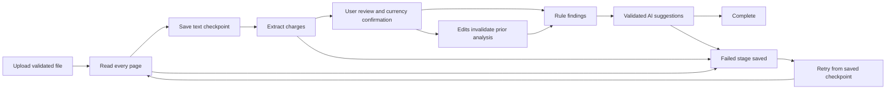

# Architecture and interview guide

## Explaining the PDF pipeline

“A PDF can contain selectable text, photographs of text, or both. My backend checks the actual file signature, size and page count first. For each page, Poppler tries to read embedded text. If the page has raster content or too little usable text, Poppler renders the whole page to a bounded-size image. Sharp normalizes that image and Tesseract reads it. This also catches scanned charges under a selectable text header.

Pages run one at a time, with only one document using OCR per server process. Every external command shares a deadline and is killed if it times out. Temporary page images are removed even after an error. The resulting text keeps page numbers and extraction methods, so users can trace a charge back to its source.

Next, a conservative parser looks for monetary columns at the end of a line. It separates charges from taxes, discounts and totals, and leaves ambiguous lines for review. The user confirms the extraction and currency before analysis. Deterministic checks produce explainable flags; Groq supplies separate suggestions that must pass schema and row-reference validation. Neither is presented as proof of a billing error.”

## Why these choices

- **Docker on the existing Render hosting:** Poppler and native Tesseract are explicit OS dependencies. An npm wrapper does not guarantee Linux binaries. The Dockerfile makes installation repeatable and allows subprocess timeouts to actually kill work.
- **Native Tesseract instead of Tesseract.js:** avoids runtime language downloads and gives a direct, killable OCR subprocess. English trained data is installed in the image. Sharp image preprocessing is retained.
- **No queue infrastructure:** this portfolio app uses request-driven processing and MongoDB checkpoints. This is proportionate, with clearly documented restart limitations; it is not a durable background worker.
- **No persistent original storage:** originals are only needed until extraction succeeds. Text and results are durable in Atlas. A missing original can be reattached to the existing record. Private object storage would be needed if durable viewing becomes a product requirement.
- **Review before AI:** OCR can misread digits and layout. Human correction is explicit, and any change invalidates the analysis so old findings cannot be shown against new amounts.
- **Currency codes:** an unqualified `$` does not establish USD. Unknown/contradictory currencies remain unknown until corrected. ISO codes are used consistently in the app and report; different currencies never share one total.

## State flow

The frontend polls persisted stage information during a request and reloads it from the bill detail endpoint after refresh. The history row is the recovery entry point; local browser storage is not the source of bill-processing truth. Request and per-bill locks are in-memory and only appropriate for one backend instance.

## Definitions used everywhere

- **Complete:** reviewed charges, persisted `complete` processing stage and validated AI result with `aiStatus: complete`.
- **Needs review:** incomplete, one or more distinct affected charge IDs, or a total discrepancy.
- **Affected charges:** union of row IDs referenced by rule findings and AI suggestions, not the sum of overlapping findings.
- **Total billed:** printed total if available, otherwise charges plus adjustments; dashboard includes only reviewed known-currency records and groups by currency. Payments and savings are not tracked.
- **No issues flagged:** complete analysis with no referenced concerns/discrepancy; not a claim that a bill is correct.

## Dependency references

- [Poppler project](https://poppler.freedesktop.org/) and [renderer options](https://github.com/tsdgeos/poppler_mirror/blob/master/utils/pdftoppm.1).
- [Tesseract command-line documentation](https://tesseract-ocr.github.io/tessdoc/Command-Line-Usage.html).
- [Tesseract.js worker guidance](https://github.com/naptha/tesseract.js/blob/master/docs/workers_vs_schedulers.md) informed the assessment of worker lifetime and memory; the final implementation uses native subprocesses.
- [Render Docker setup](https://render.com/docs/docker) and [binding requirements](https://render.com/docs/web-services).

## Tradeoffs to discuss honestly

Any raster image triggers whole-page OCR, including a logo on an otherwise textual page. This favors completeness over speed and can reduce text fidelity; users must review the extracted text. Tables with unusual layouts, decimal-comma notation, handwriting, per-line currency mixtures or complex insurance/payment sections may need manual correction. Price thresholds are disabled unless explicitly configured and are not authoritative price benchmarks. Live Groq output is structurally validated, not fact-verified.
